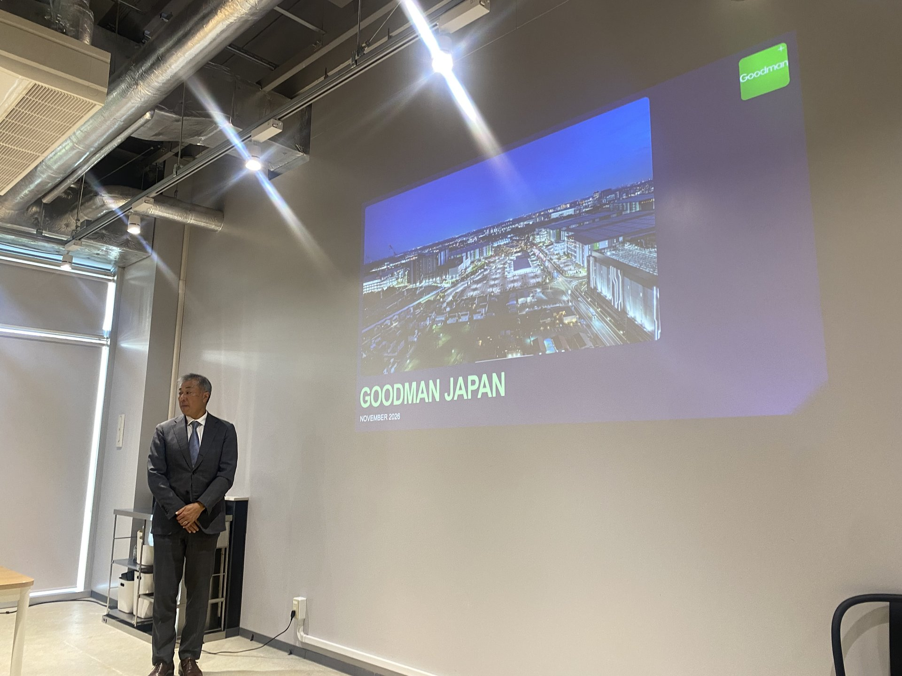
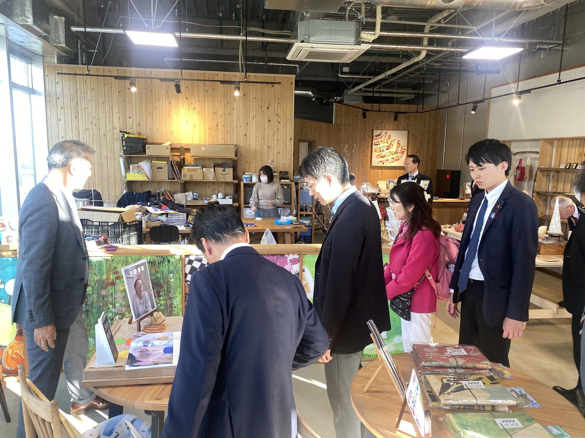

千葉県印西市で、物流施設とデータセンターが一体となった約50ヘクタールの「グッドマンビジネスパーク」を視察しました。園内には保育施設や芝生広場、カフェがあり、夏祭りなどのイベントで近隣の方も集う場になっています。騒音は防音で抑え、非常用発電機も建物の中に収めているとの説明でした。

南区でも、市街化調整区域での土地区画整理によるまちづくりが計画されています。地権者の方からは、置き場のコンテナについて市から連絡があったとご相談もいただきました。500人を超える地権者の皆さんの合意が欠かせない事業です。形式的な指導から入るのではなく、顔の見える対話を重ね、地域に開かれたまちづくりにつなげていきます。
