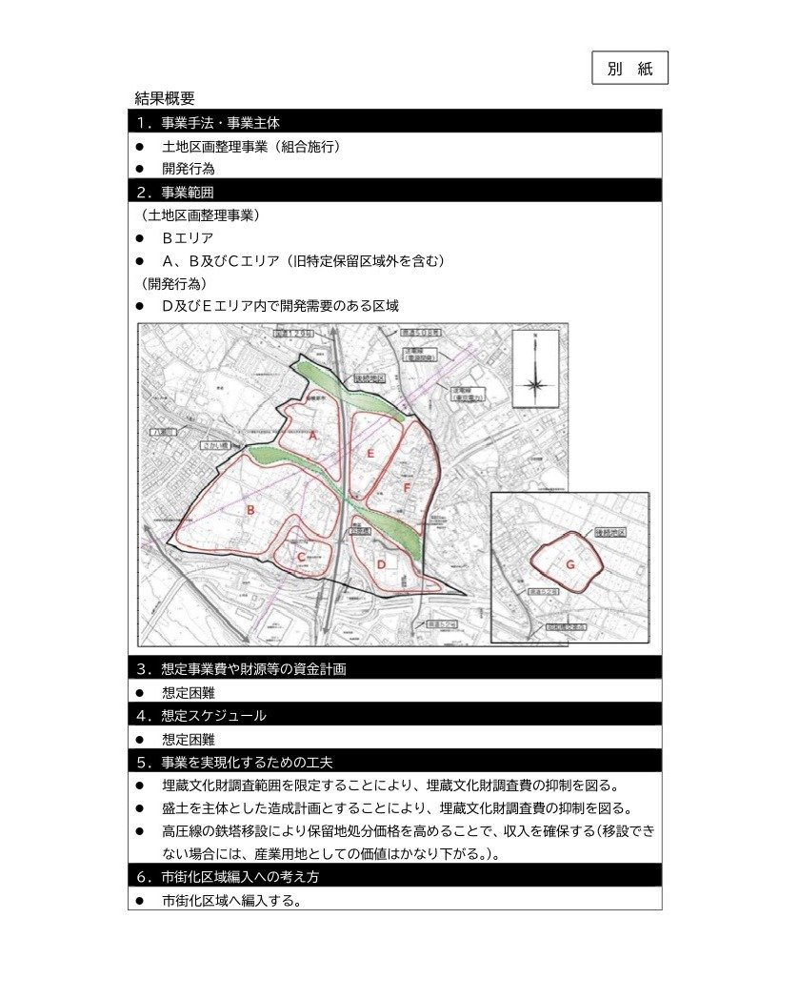
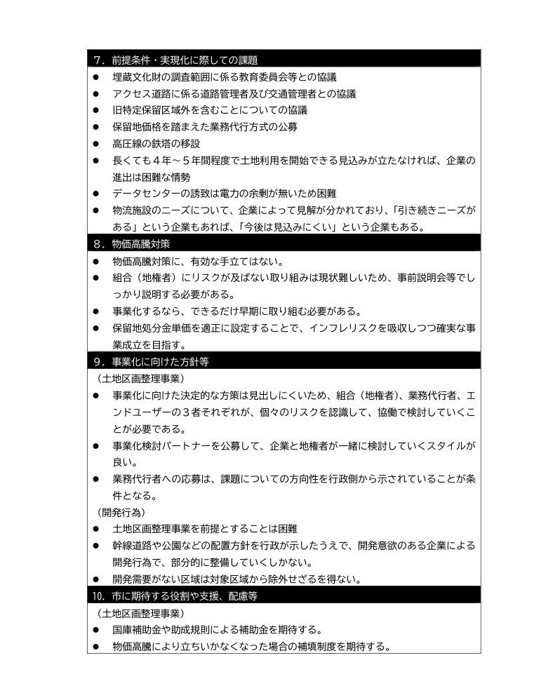

市街化調整区域にある地区のまちづくりについて、市の担当部局から、民間事業者への意見聴取の結果を伺いました。送電線の鉄塔や埋蔵文化財、幹線道路からのアクセス、物価高騰など、地区全体の開発には多くの課題があるという内容でした。

この地区の出発点は、浄化槽ではなく下水道につなぎたいという住民の皆さんの切実な願いです。周りの開発が進むなかで、ここだけが取り残されるのは公平性の観点から見過ごせません。

下水道を整備するのか、浄化槽の負担を軽くする手立てを考えるのか。住民の皆さんに寄り添った方針を示すよう市に求めました。
