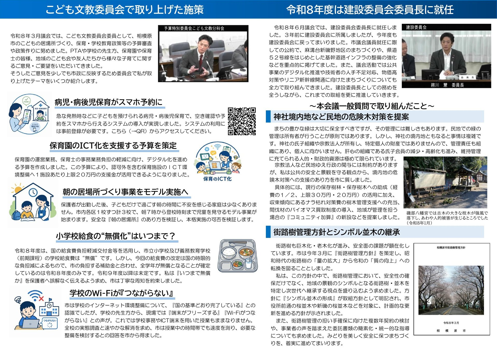

市政報告vol.18（令和8年第2号）をホームページに掲載しました。

今号の特集は教職員不足です。相模原市でも教員の欠員は令和6年度の27名から7年度は33名に増えています。現場の先生方との対話をもとに、教員が安心して働ける職場づくりと、学校の統合・再編を急いで適正規模にすることを議会で求めました。

ほかにも、病児・病後児保育のスマホ予約、朝の居場所づくりのモデル事業、学校のWi-Fiの実態調査、神社境内の危険木対策や街路樹の管理などを紹介しています。

ホームページの「市政報告レポート」のページから、ぜひご覧ください。

[市政報告vol.18（PDF）はこちら](/report/市政報告vol18.pdf)
