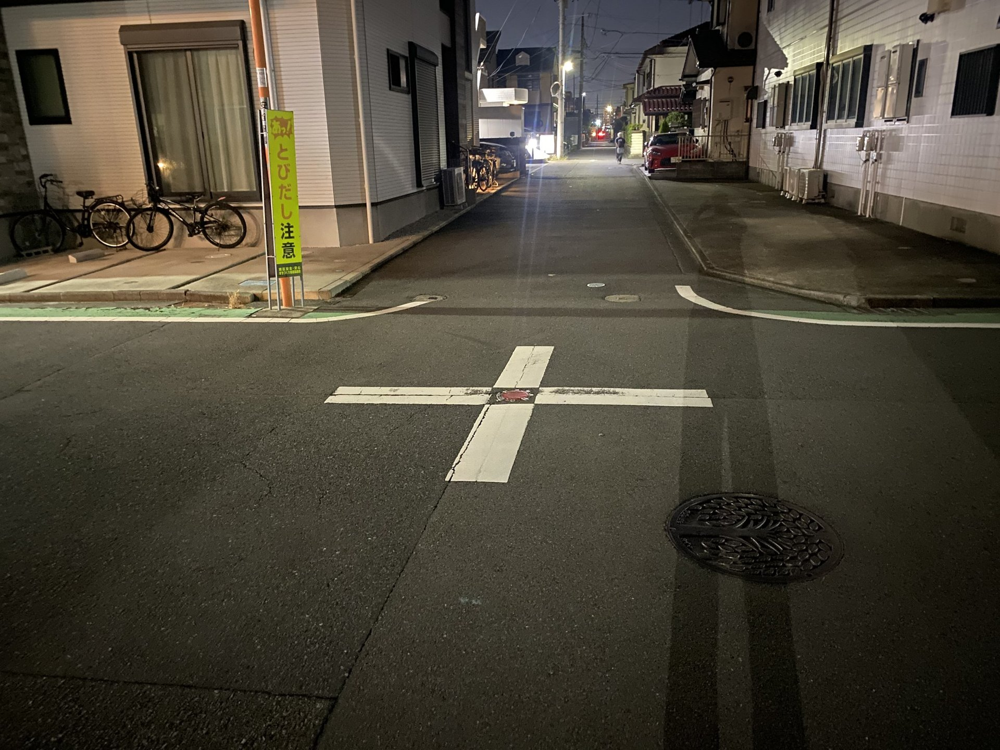

地域の方からご相談をいただき、事故が絶えない交差点を見に行きました。先日は車が民家に突っ込む事故があり、現場の写真を見せていただくと、その衝撃の大きさに言葉を失いました。

地元の事情を知らずに走ってくると、どちらが優先なのか分かりにくい形の交差点で、ヒヤリハットは数えきれないとのこと。駅へ抜ける車が多く通り、緑台小学校の通学路にもなっています。

すぐ近くの交差点には停止線やカラー舗装が整っています。ここにもまず停止線が必要です。連合自治会長にご相談し、同じ地域の山口市議会議員とも連携して、書面で要望を進めていきます。
