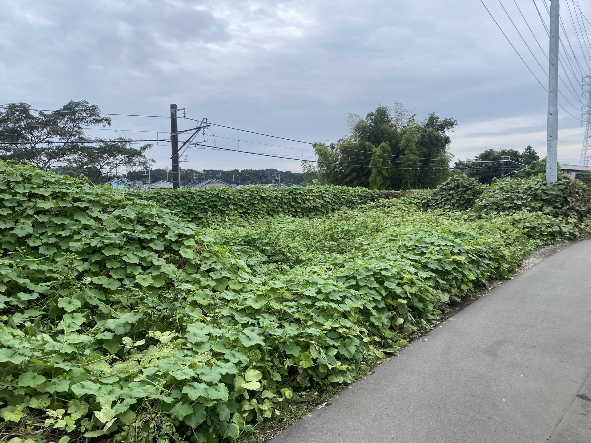
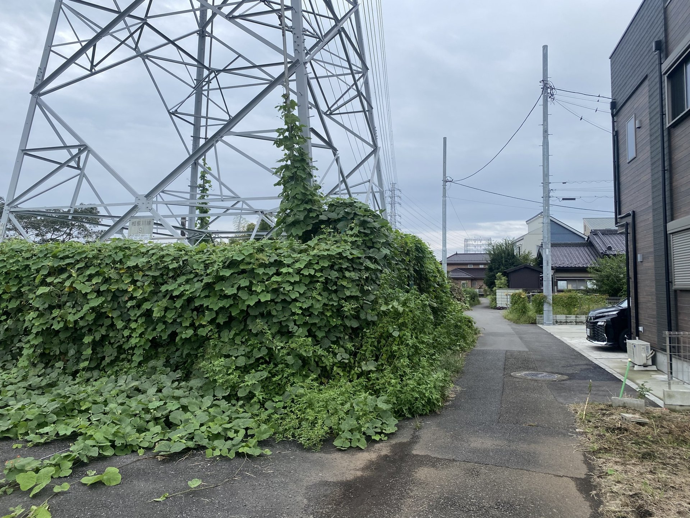

地域のお祭りで、若いご夫婦から、鉄塔のあたりに生い茂る葛が車に擦れて困っているとご相談をいただきました。調べてみると、土地が細かく分かれた民有地で、市がすぐに刈り取ることはできません。自治会長さんにつないで、地主さんも含めた話し合いを進めていただくことにしました。

また、旧県立高校の跡地のほとんどが使われないまま、草が伸び放題になっているというお声も伺いました。立派な施設と広い土地がもったいない、という思いはもっともです。

県の土地、市の土地、民有地と持ち主が違うからこそ、困りごとが届かないまま残ることがあります。しかるべきところへ一つずつつないでいきます。
