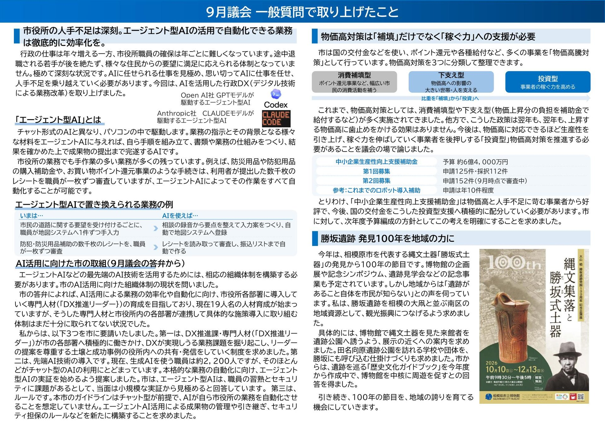

市政報告vol.19（令和8年第3号）をホームページに掲載しました。

今号の特集は、くらしを守る防災・ごみの管理・まちづくりです。防災用品の購入費を半額補助する制度（1世帯最大1万円、12月15日まで先着順）や、10月からのごみ出しの変更と戸別収集の検討、麻溝台・新磯野へのスーパー誘致の見通しを紹介しています。

9月議会の一般質問では、エージェント型AIによる市役所の業務改革、「稼ぐ力」を伸ばす物価高対策、勝坂遺跡発見100年を地域の力にする取り組みを取り上げました。

ホームページの「市政報告レポート」のページから、ぜひご覧ください。

[市政報告vol.19（PDF）はこちら](/report/市政報告vol19.pdf)
