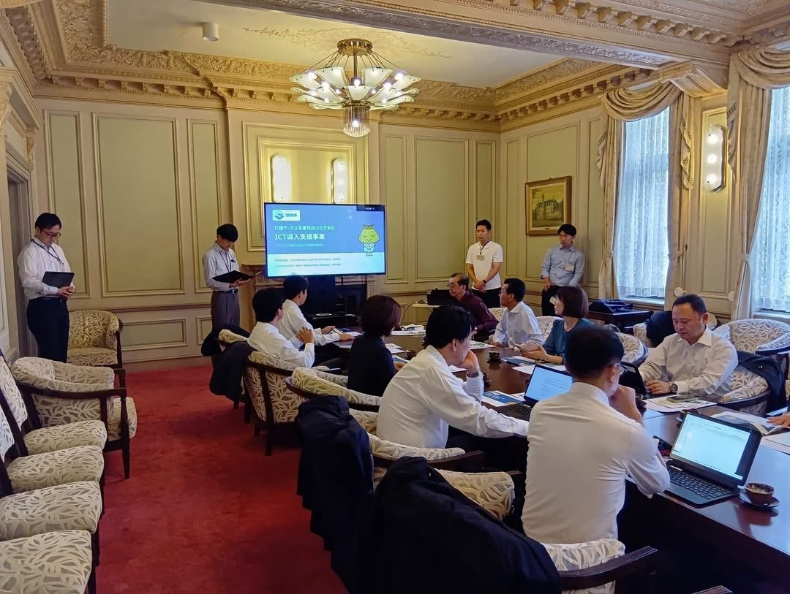

10月19日、特別委員会で静岡市を訪れ、ウェアラブル端末を活用した介護現場の取り組みを学びました。介護事業所を利用する方に市がスマートウォッチ型の端末を無償で貸し出し、歩数や睡眠、心拍数などのデータを事業所と共有しています。

毎月のレポートをもとに、数字を使った会話が生まれ、ご本人の健康意識の向上につながっているそうです。一方で、データ確認が新たな業務になることや、要介護度の高い方には使いにくいことなど、課題も率直に伺いました。

介護人材の確保と重度化の防止は、相模原でも大きなテーマです。実際に端末にも触れながら学んだことを、相模原の介護の現場づくりに生かしていきます。
