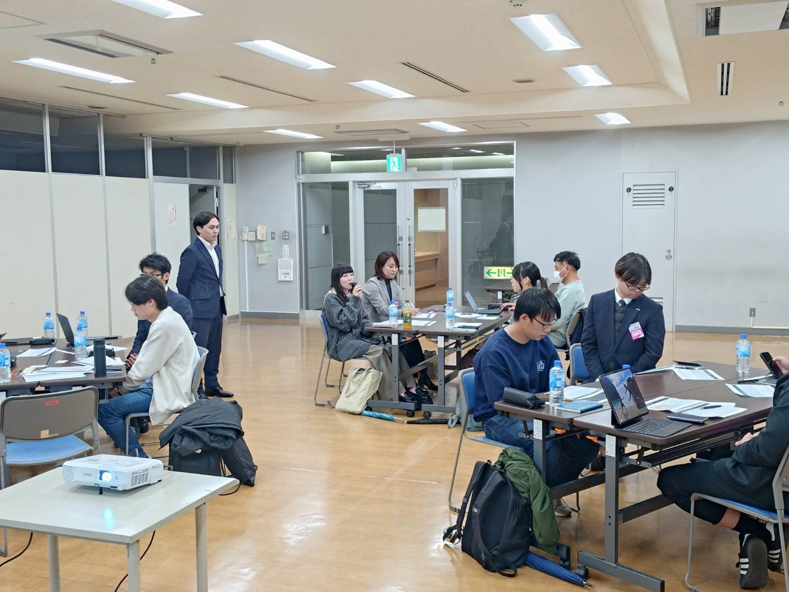

10月14日、JC（青年会議所）地域経済活性化委員会の仲間と、リニア中央新幹線を見据えた相模原の街づくりを話し合い、第3回に向けた打ち合わせも行いました。

私が伝えたのは産業の視点です。相模原の工業団地には、半導体やAI産業が求める要素技術を持つ中小企業がそろっています。リニアは目的ではなく、その強みを生かす手段だと考えています。

仲間からは、雇用が生まれたときに選ばれる住みよい街という切り口が出され、第3回は「住みよい」をテーマに議論を深めることになりました。

一年間の議論を次年度につなげられるよう、仲間と一緒に形にしていきます。
