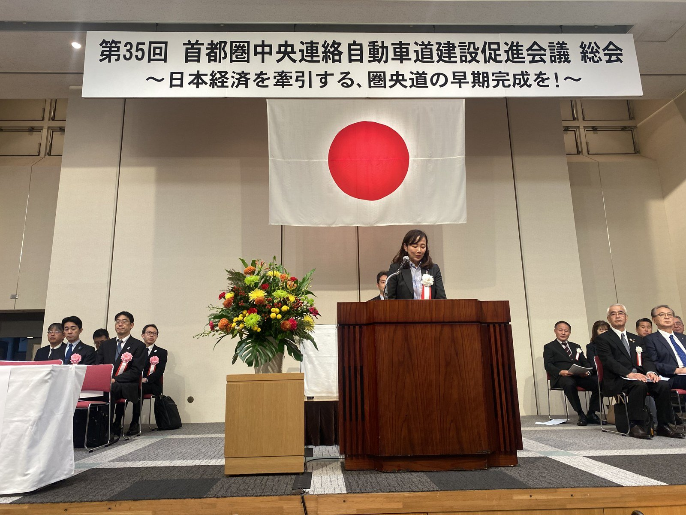
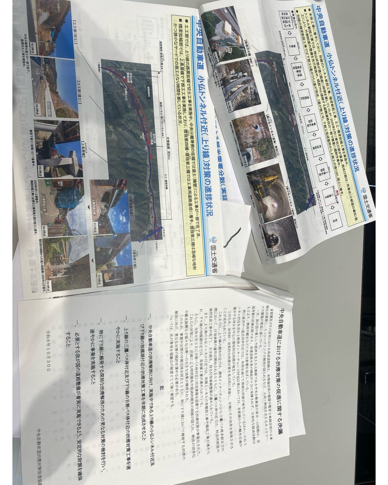

10月30日、第14回中央自動車道渋滞対策促進大会に出席しました。東京都・神奈川県・山梨県・長野県・相模原市でつくる協議会の大会で、副会長の本村相模原市長が、小仏トンネル付近と相模湖付近の渋滞対策工事の早期完成や、道路財源の確保などを求める決議を読み上げました。商工会議所からは、渋滞でバスの定時性を保てないという切実な声もありました。

11月2日には圏央道建設促進会議の総会に出席し、未開通区間の全線開通と4車線化を求める決議が採択されました。

両路線の整備は物流や観光、暮らしに直結します。建設委員会の立場から、進捗をしっかり確認していきます。
