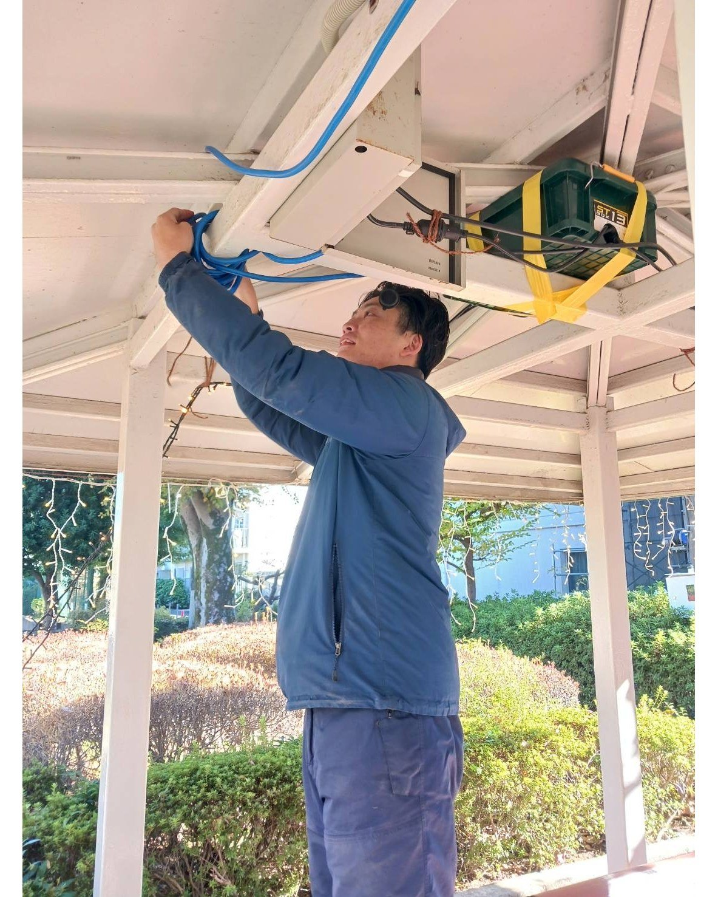

先週末は、グリーンパークのイルミネーション設置作業に汗を流しました。

11月16日には、相模原YEGが市の課長級職員の皆さんを招いた「相模原ガチ会議」に参加しました。

テーマは次期総合計画の策定、相模総合補給廠の返還地を生かす相模原駅北口のまちづくり、リニア駅を核とした橋本駅南口の開発と産業ビジョン、小田急多摩線の延伸など。若手経済人からは、新しい拠点の周りの商店街が寂れないか、企業用地を確保できるか、と率直な声が出ました。

職員の皆さんが踏み込んで答え、行政と経済界が同じテーブルで語る意義を実感しました。YEGは来年9月ごろの政策提言を目指しています。15年、20年先の相模原を見据え、私も議員として、その議論を受け止めていきます。
