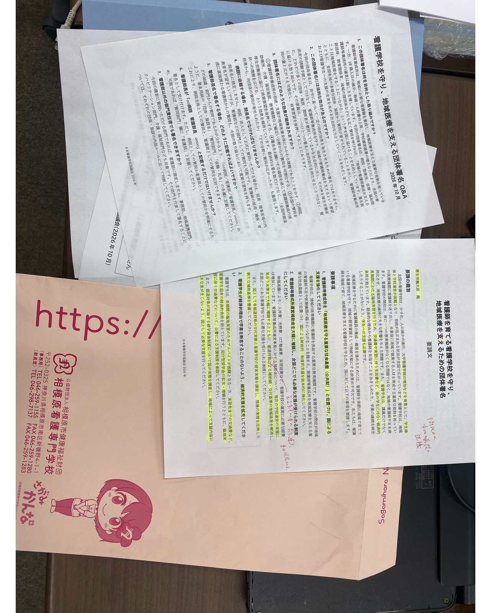

11月25日、相模原看護専門学校の皆さんから、日本看護学校協議会が厚生労働大臣に届ける要望について、市議団として説明を受けました。

看護学校を志す学生は全国的に減っています。大学の増加や少子化に加え、他の職種との賃金差が縮まっていることも背景にあるそうです。一方で専門学校の卒業生は地元に就職する割合が高く、同校では昨年、約95%が市内の病院に就職したとのことです。

要望は、運営費補助の増額と地域差の解消、実習の交通費などがかさむ学生への経済的支援、統廃合を前提としない学校の存続など5項目です。

看護学校は相模原の地域医療を支える大切な基盤です。署名については会派でしっかり検討します。
